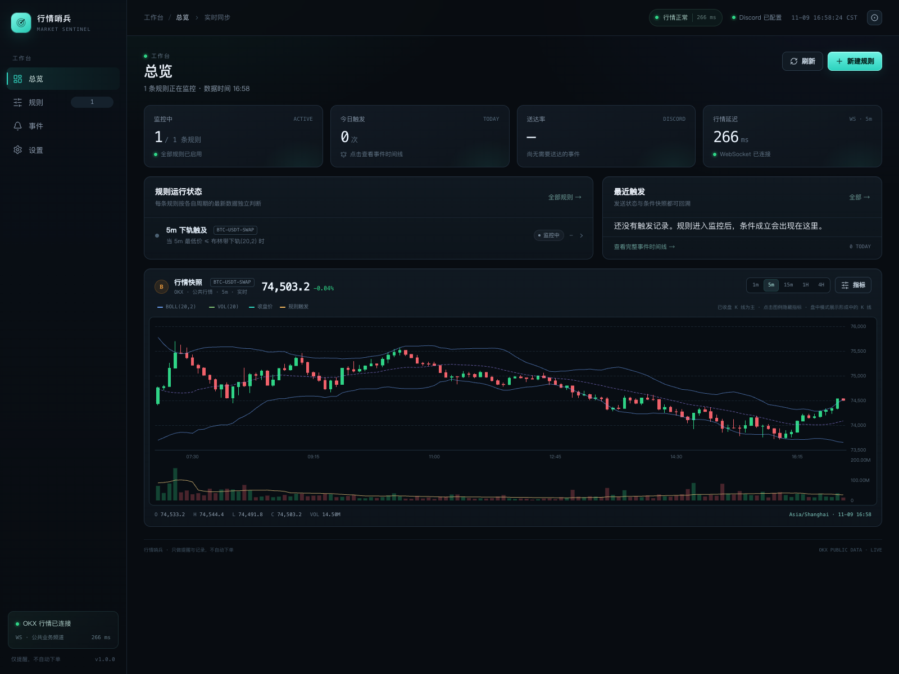
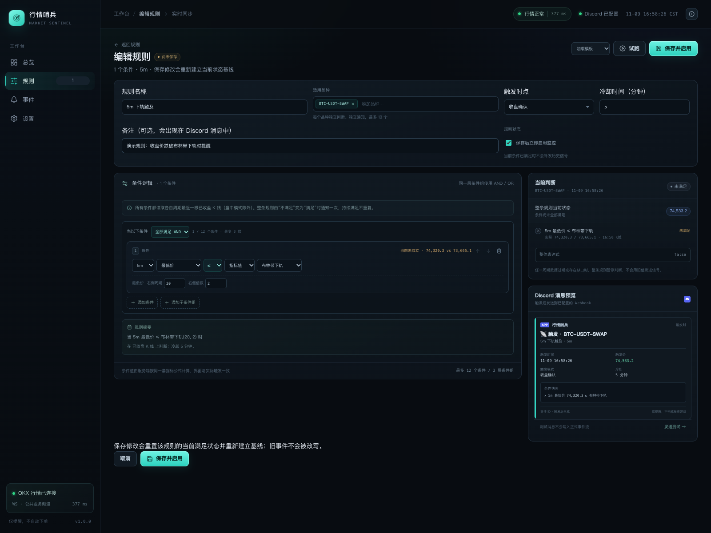
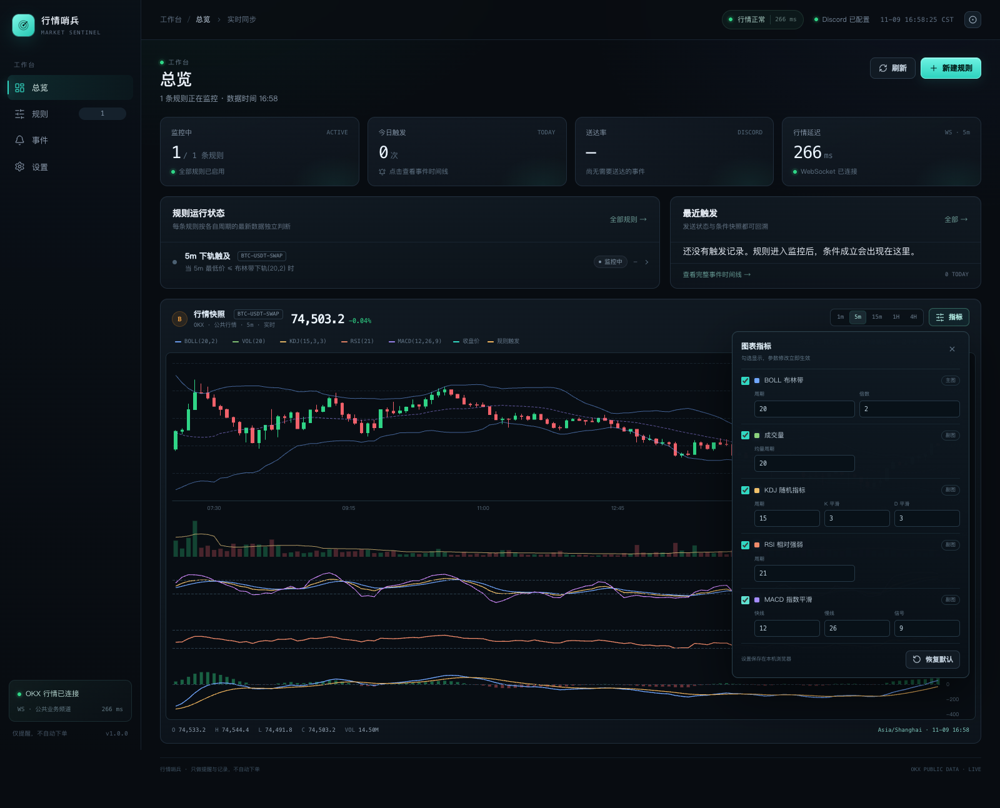
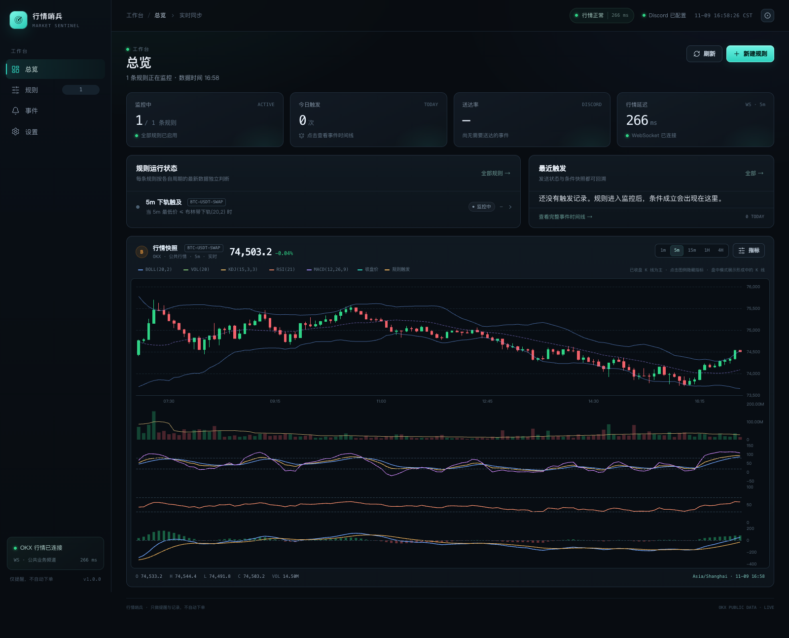
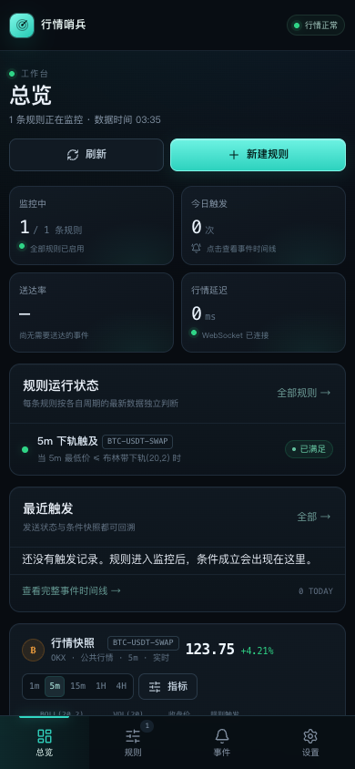
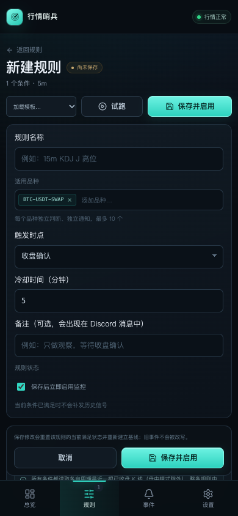
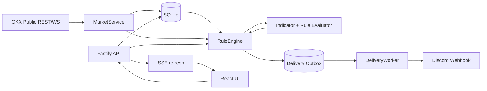
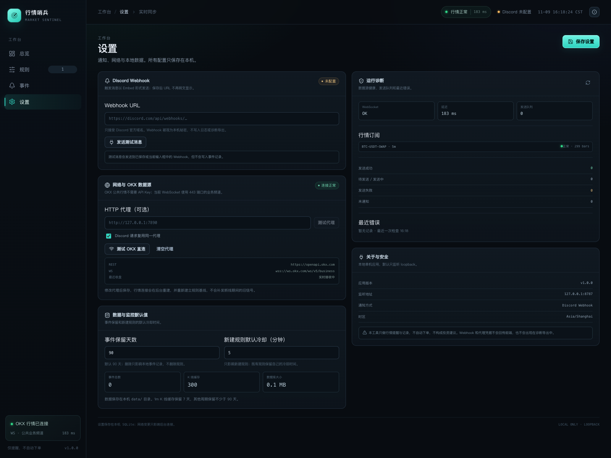

# 行情哨兵 · Market Sentinel

> 本地优先的 OKX 行情指标监控台：用可视化条件组合 Bollinger Bands、KDJ、RSI、MACD 与成交量，在条件由“不满足”变为“满足”时通过 Discord Webhook 提醒，并保留完整的触发快照。
>
> A local-first OKX market indicator monitor with visual rules, a deterministic edge-triggered engine, Discord alerts, and a full audit trail. No OKX API key required.

[](https://github.com/Domingozll/market-sentinel/actions/workflows/ci.yml)
[](LICENSE)
[](https://nodejs.org/)
[](docker-compose.yml)

> 仅提供行情提醒与记录，不自动下单，不构成投资建议。  
> Not affiliated with OKX or Discord.



> 截图来自本地 Docker 验收环境，展示了一条演示规则。

---

## 目录

- [为什么做这个项目](#为什么做这个项目)
- [功能](#功能)
- [快速开始](#快速开始)
- [首次使用](#首次使用)
- [规则语义](#规则语义)
- [架构](#架构)
- [配置](#配置)
- [API](#api)
- [开发](#开发)
- [测试](#测试)
- [部署与运维](#部署与运维)
- [安全](#安全)
- [项目结构](#项目结构)
- [路线图](#路线图)
- [贡献](#贡献)
- [常见问题](#常见问题)
- [限制与免责声明](#限制与免责声明)
- [许可证](#许可证)

## 为什么做这个项目

很多指标提醒工具要么依赖托管服务，要么只支持单条件，要么在收盘时用旧数据补发信号。Market Sentinel 关注三件事：

1. **本地优先**：行情、规则、事件和密钥都留在自己的机器上，不需要 OKX API Key。
2. **语义明确**：整条表达式由 false 变 true 才触发；默认收盘确认；数据过期、缺口、断线恢复时不补发旧信号。
3. **可解释**：每条通知都带条件快照；事件保存当时的规则版本，后续编辑规则不会改写历史。

适合个人在本地运行、长期迭代自己的指标规则，也适合作为行情/规则引擎的工程参考。

## 功能

### 行情

- OKX 公共 REST + WebSocket，现货与 USDT 永续。
- 周期：`1m`、`3m`、`5m`、`15m`、`30m`、`1H`、`2H`、`4H`、`1D`。
- WebSocket 断线重连、心跳、REST 对账、历史缺口补洞。
- 1D 使用交易所日界（OKX 实测为 UTC+8）。
- 成交量使用 `volCcyQuote`（报价货币成交额）。

### 指标与条件

- Bollinger Bands：`price`、上/中/下轨、带宽、`%B`、中轨斜率。
- KDJ：K、D、J、金叉/死叉辅助序列。
- RSI（Wilder）、MACD（DIF/DEA/柱）。
- 成交量、均量、量能倍数。
- AND / OR 嵌套条件组，最多 12 个叶子条件、3 层嵌套。
- 支持指标对固定数值、指标对指标比较。

### 规则引擎

- 整条表达式边沿触发，持续满足不重复。
- 收盘确认默认开启；可逐规则切换盘中触发。
- 多周期使用各自最新已收盘 K 线，同时收盘合并评估。
- `规则 × 品种 × K 线` 数据库唯一键，天然幂等。
- 冷却时间可配置，重启后保留。
- 数据过期、缺口、恢复连接时暂停判断并重建基线。
- 迟到超过 2 分钟的收盘信号直接抑制，不补发。

### 通知与审计

- Discord Embed，包含规则、品种、周期、价格、条件快照、事件 ID。
- `allowed_mentions.parse = []`，默认禁止所有 mention。
- SQLite outbox 投递队列；429 遵守 `Retry-After`；5xx 退避重试；4xx 永久失败。
- 事件详情支持手动重发。
- Webhook URL 保存后只显示掩码，不写入日志/诊断/API 响应。

### 界面与工具

- React 19 + ECharts 6 的本地 UI。
- 总览、规则、事件、设置。
- 实时 SSE 刷新。
- 规则编辑器实时预览、当前判断、Discord 消息预览。
- 行情图指标可配置：BOLL、KDJ、RSI、MACD、成交量独立开关，参数即时生效并保存在本机浏览器。
- 响应式移动端布局：底部导航、双列指标卡、可滚动筛选栏、全屏事件抽屉、底部弹层和移动端指标面板。
- 历史试跑：回看 7/30 天，统计触发次数（不计算盈亏）。
- 安全静态文件服务、CSP、CSRF Origin 校验；默认仅本机访问，可显式开启可信局域网访问。

## 快速开始

### Docker（推荐）

前置要求：Docker Desktop 或 Docker Engine + Compose 插件。

```bash
git clone https://github.com/Domingozll/market-sentinel.git
cd market-sentinel
docker compose up -d --build
```

打开 <http://127.0.0.1:8787>。

```bash
docker compose ps
docker compose logs -f market-sentinel
docker compose down       # 停止并保留 ./data
```

可选环境变量：

```bash
cp .env.example .env
# 编辑 .env：
# BIND_HOST=0.0.0.0          # 可选：允许可信局域网访问
# PROXY_URL=http://127.0.0.1:7890
# DISCORD_WEBHOOK_URL=https://discord.com/api/webhooks/...
docker compose up -d --build
```

容器默认只把端口发布到宿主机 `127.0.0.1`。数据保存在仓库的 `data/`。

#### 局域网访问

应用本身不提供登录/权限系统。仅在可信局域网中按以下方式开启：

```bash
cp .env.example .env        # 如果还没有 .env
# 编辑 .env：BIND_HOST=0.0.0.0
docker compose up -d
```

用本机局域网 IP 访问，例如 macOS 上：

```bash
ipconfig getifaddr en0      # 例如 192.168.1.4
# 浏览器打开 http://192.168.1.4:8787
```

开启后，任何能访问该端口的人都能查看行情与规则、修改设置和 Webhook，并可创建/删除规则。不要做公网端口转发；如必须跨网络访问，请使用 VPN 或带认证的反向代理，并通过防火墙限制来源。

### 本地开发

要求 Node.js **24+**（使用内置 `node:sqlite`）。

```bash
npm ci

# 终端 1：后端 API + 规则引擎
npm run dev

# 终端 2：Vite 前端（带 /api 代理）
npm run dev:web
# 打开 http://127.0.0.1:5173
```

生产构建：

```bash
npm run build
npm start
# http://127.0.0.1:8787
```

## 首次使用

1. 打开“设置”，填写 Discord Webhook URL，保存。
2. 点击“发送测试消息”，确认 Discord 收到。
3. 进入“规则”，从模板创建一条规则，例如“下轨触及”。
4. 保存并启用；系统会重建当前基线，之后条件从假变真时通知。
5. 在“事件”页查看触发快照、投递状态和错误信息。



### 可配置行情图

点击行情图右上角的“指标”按钮，可以独立开关 BOLL、成交量、KDJ、RSI、MACD，并调整每个指标的周期、倍数、平滑参数。设置立即作用于主图/副图，并保存在当前浏览器；刷新页面后仍会保留。

也可以直接点击图例中的指标标签隐藏它，再通过“指标”面板重新打开。





### 移动端

在手机和窄屏上，侧栏会切换为底部导航；指标卡变为双列，规则行改为可操作的紧凑卡片，事件行改为摘要卡片，事件详情为全屏抽屉，指标设置和试跑弹窗使用贴近底部的移动端弹层。

已在 **390px 手机视图**、**768px 平板视图** 和 **1024px 窄桌面视图** 下通过浏览器 E2E，覆盖横向溢出、底部导航、图表指标面板、事件抽屉和规则编辑器堆叠。

| 手机总览 | 手机规则编辑器 |
|---|---|
|  |  |

## 规则语义

### 触发

所有条件默认在各自周期最近一根**已收盘** K 线上计算。整条规则从 false 变为 true 时产生一次触发；持续满足不会重复触发。

```text
15m KDJ J >= 90
15m BB 中轨斜率 > 0 AND 5m 最低价 <= 5m BB 下轨
5m MACD 柱 > 0 AND 5m 成交量 >= 20 根均量 × 2
```

“触及下轨”的默认口径是 `low <= lower`，包含影线；也可以改为收盘价口径。

“并且”表示同一评估时刻都成立，**不是**“A 发生后 N 根内 B 发生”的序列条件。

### 多周期

每个条件读取自己的最新已收盘 K 线。多周期同时收盘时合并评估；任一被引用周期数据过期或缺口时，整条规则暂停判断。

### 盘中触发

可逐规则开启。盘中模式使用当前未收盘 K 线，指标会随价格变化重绘；消息会标注“盘中、可能失效”。运行期间每个最短周期最多产生一个事件，收盘后更新“收盘是否确认”。

### 启动、编辑、断线

- 启动、规则启用、规则编辑后都会重建基线，不补发旧信号。
- 行情断线/缺口恢复后重建基线，不补发断线期间信号。
- 冷却时间在重启后保留。

### 试跑

试跑使用历史已收盘 K 线按相同公式回放，统计触发次数，不计算盈亏、不发送 Discord、不写正式事件。历史盘中路径无法精确还原，因此按收盘口径模拟。

## 架构



关键设计：

- **单一评估器**：规则试跑和线上判断共用同一套指标/表达式实现，避免“试跑和实盘不一致”。
- **本地优先**：SQLite WAL 存储规则、状态、事件、投递、K 线和设置。
- **可恢复**：启动和断线后重新基线；事件写入使用唯一键去重。
- **可解释**：通知使用事件快照，不依赖当前规则内容。
- **失败可观察**：投递状态、HTTP 次数、最近错误、行情 pair 健康度都可在 UI/诊断中看到。

更完整的需求、交互和边界条件见 [设计文档](docs/DESIGN.md)。

## 配置



### 环境变量

| 变量 | 默认 | 说明 |
|---|---|---|
| `HOST` | `127.0.0.1` | 应用监听地址；Docker 内为 `0.0.0.0` |
| `BIND_HOST` | `127.0.0.1` | 仅 Docker Compose：宿主机发布接口；`0.0.0.0` 允许可信局域网访问 |
| `PORT` | `8787` | HTTP 端口 |
| `DATA_DIR` | `./data` | SQLite 数据目录 |
| `APP_BASE_URL` | `http://127.0.0.1:8787` | 诊断/日志中的基础地址 |
| `OKX_REST_BASE` | `https://openapi.okx.com` | OKX 公共 REST |
| `OKX_WS_URL` | `wss://ws.okx.com/ws/v5/business` | OKX 业务 WebSocket |
| `PROXY_URL` | 空 | 可选 HTTP 代理，REST/WS 共用 |
| `DISCORD_WEBHOOK_URL` | 空 | 首次启动的可选初始 Webhook |
| `TZ` | `Asia/Shanghai` | 日志/显示时区 |
| `LOG_LEVEL` | `info` | Fastify 日志级别 |

`DISCORD_WEBHOOK_URL` 只在数据库中尚无配置时作为初始值；之后以 UI 保存的设置为准。

### 设置页

- Discord Webhook 与测试消息
- HTTP 代理与 Discord 复用开关
- OKX 连通性测试
- 事件保留天数
- 新建规则默认冷却
- 运行诊断、行情订阅、投递队列、最近错误

### 数据保留

- 事件默认保留 90 天，可配置。
- `1m` K 线缓存 7 天，其他周期至少 7 天。
- 删除规则为归档，不物理删除历史事件。
- 备份：停止服务后复制 `data/`；恢复时放回后启动。

## API

完整接口、请求示例和 SSE 格式见 [API 文档](docs/API.md)。

高层接口：

| 方法 | 路径 | 说明 |
|---|---|---|
| GET | `/api/health` | 进程/版本/连接状态 |
| GET | `/api/dashboard` | 总览聚合 |
| GET/POST | `/api/rules` | 规则列表/创建 |
| GET/PUT/DELETE | `/api/rules/:id` | 规则详情/更新/归档 |
| PATCH | `/api/rules/:id/enabled` | 启用/暂停 |
| POST | `/api/rules/validate` | 规则校验 |
| POST | `/api/rules/preview` | 当前条件实时判断 |
| POST | `/api/rules/trial` | 历史试跑 |
| GET | `/api/events` | 事件列表 |
| GET | `/api/events/:id` | 事件详情 |
| POST | `/api/events/:id/retry` | 手动重发 |
| GET | `/api/candles` | K 线数据 |
| GET | `/api/instruments` | OKX 品种 |
| GET/PUT | `/api/settings` | 配置 |
| POST | `/api/settings/test-okx` | OKX 连通性 |
| POST | `/api/settings/test-discord` | Discord 测试 |
| GET | `/api/diagnostics` | 诊断 |
| GET | `/api/stream` | SSE 刷新流 |

## 开发

### 技术栈

- Node.js 24、TypeScript、Fastify 5
- React 19、Vite 6、ECharts 6
- SQLite（内置 `node:sqlite`，WAL）
- WebSocket `ws`
- Vitest 5、Playwright、Testing Library

### 目录

```text
src/server/       行情、指标、规则引擎、API、Discord 投递
src/web/          React UI
src/shared/       前后端共享类型、指标目录
tests/unit/       指标/规则/引擎/试跑/前端工具与组件测试
tests/integration/ API、OKX、Discord、行情服务、安全
tests/e2e/        Playwright 端到端
docs/             设计、API、截图
docker/           容器入口脚本
```

### 开发约定

- 保持规则试跑与线上评估共用 `src/server/rules/evaluator.ts`。
- 时间统一使用毫秒时间戳；显示时明确时区。
- 不在日志、错误、API 响应中输出 Webhook 或代理凭据。
- 修改规则语义时，同步更新设计文档、试跑和测试。
- 新增指标需同时提供参数校验、目录元数据、前端参数控件和公式测试。

### 常用命令

```bash
npm run typecheck
npm test
npm run test:watch
npm run test:e2e
npm run test:all
npm run build
npm run smoke          # 对已运行的实例做无副作用探活
```

## 测试

当前版本包含：

- **98** 个单元/集成测试（19 个文件）
- **6** 个浏览器 E2E 场景（含手机 / 平板 / 1024px 断点）
- 加速 3 天行情回放（864 根 5m K 线）
- OKX REST/WS 模拟服务、断线重连、Discord 重试、SSE、安全静态资源、Docker 验收

```bash
npm test
npm run test:e2e
npm run smoke
```

E2E 默认使用本机 Google Chrome；在 CI 中使用 Playwright 自带 Chromium：

```bash
npx playwright install --with-deps chromium
PLAYWRIGHT_CHANNEL=bundled npm run test:e2e
```

测试策略、覆盖矩阵、缺陷修复记录和真实容器验收见 [TEST_REPORT.md](TEST_REPORT.md)。

## 部署与运维

### Docker Compose

```yaml
services:
  market-sentinel:
    build: .
    ports:
      - "${BIND_HOST:-127.0.0.1}:8787:8787"
    volumes:
      - ./data:/app/data
    restart: unless-stopped
```

- 容器内以非 root 的 `node` 用户运行应用；入口脚本仅用于数据目录授权。
- 健康检查访问 `/api/health`；只看进程存活，不因 OKX 暂时不可用而反复重启。
- 日志按 10 MB × 5 文件轮转。
- 数据目录使用 0700，数据库文件 0600。

### 代理

在设置页填写 HTTP 代理，例如 `http://127.0.0.1:7890`。REST 和 WebSocket 同时使用；Discord 可选择是否复用。保存后行情会自动重建并重新基线。

### 故障排查

1. `docker compose logs -f market-sentinel` 查看启动/退出错误。
2. 总览页看行情连接、数据时间和 pair 健康度。
3. 设置页看 OKX/Discord 测试结果、投递队列和最近错误。
4. 规则显示“预热中”说明尚未完成基线；等待下一根 K 线或检查数据。
5. 没有通知时确认：Webhook 已配置、规则已启用、条件刚发生边沿、未处于冷却、非旧数据补发。

## 安全

- 默认只绑定 loopback；仅在可信局域网设置 `BIND_HOST=0.0.0.0`，不要将 `8787` 暴露到公网。应用没有登录认证，局域网内任何可达主机都能修改规则和设置。
- 不请求 OKX API Key；只访问公共行情。
- Webhook/代理凭据保存在本地 SQLite，依赖本机账户和磁盘权限。
- Webhook 仅接受 Discord 官方 HTTPS Webhook 域名。
- 写请求校验 `Origin`/`Host`；跨站表单无法直接调用。
- Discord 消息禁用 mentions。
- 安全静态文件服务：无目录列表、无点文件、无 web root 外读取；设置 CSP 等响应头。
- 已知漏洞披露方式见 [SECURITY.md](SECURITY.md)。

## 项目结构

```text
.
├── src/
│   ├── server/
│   │   ├── alerts/       Discord payload、投递 worker
│   │   ├── api/          Fastify 路由
│   │   ├── market/       OKX REST/WS、行情服务、数据质量
│   │   ├── rules/        schema、evaluator、engine、summary
│   │   ├── indicators.ts
│   │   ├── store.ts
│   │   └── ...
│   ├── shared/
│   └── web/
├── tests/
├── docs/
│   ├── DESIGN.md
│   ├── API.md
│   └── screenshots/
├── docker/
├── Dockerfile
├── docker-compose.yml
├── README.md
├── SECURITY.md
├── CONTRIBUTING.md
├── CHANGELOG.md
├── LICENSE
└── ...
```

## 路线图

- [ ] 多 Webhook / 按规则路由到不同频道
- [ ] Telegram / 邮件等更多通知通道
- [ ] 规则版本历史与 diff
- [ ] 序列条件（A 后 N 根内 B）
- [ ] 更多交易所与现货/合约统一抽象
- [ ] 更完整的试跑统计（最大回撤/触发分布，不宣称盈利）
- [ ] 发布官方 Docker 镜像与 GHCR
- [ ] 国际化（中/英）

路线图是方向而不是承诺；欢迎在 Issue 中讨论优先级。

## 贡献

欢迎提交 bug、规则语义建议、指标实现和文档改进。开始之前请阅读 [CONTRIBUTING.md](CONTRIBUTING.md) 和 [CODE_OF_CONDUCT.md](CODE_OF_CONDUCT.md)。

快速流程：

```bash
git clone https://github.com/Domingozll/market-sentinel.git
cd market-sentinel
npm ci
npm test
```

- 使用 feature branch。
- 提交前运行 `npm run typecheck`、`npm test`；涉及 UI 时再运行 `npm run test:e2e`。
- 明确说明行为变化、测试覆盖和兼容性影响。
- 不要提交真实 Webhook、代理凭据、数据库或 `data/`。
- 新功能请附带对应测试；行为变更请更新文档。

## 常见问题

### 为什么没有 OKX API Key？

只使用 OKX 公共行情接口，不需要下单权限，也避免保存交易所密钥。

### 为什么规则一直显示“预热中”？

规则需要至少 200 根历史 K 线，并在最新已收盘 K 线上完成一次基线。检查行情订阅是否健康、数据时间是否新鲜。

### 为什么条件满足但没有收到通知？

按边沿触发设计，持续满足不会重复提醒；触发还受冷却、Webhook 配置、数据新鲜度和“迟到信号抑制”影响。先看事件页和设置页诊断。

### 支持自动交易吗？

不支持，也不计划在核心里做自动下单。本项目只负责提醒和审计。

### 能多人使用吗？

当前是单用户本地应用，没有账号体系。可以在可信局域网通过 `BIND_HOST=0.0.0.0` 访问，但任何能访问端口的人都能修改设置/Webhook；公网访问必须使用 VPN 或带认证的反向代理。

### 升级会丢数据吗？

正常升级保留 `data/` 即可。破坏性 schema 变更会在 CHANGELOG 中说明；升级前建议备份 `data/`。

## 限制与免责声明

- 单机运行；电脑睡眠、Docker 停止或进程退出时不监控。
- 单一 OKX 数据源；单一 Discord Webhook。
- 规则组合是 AND/OR 同时成立，不是序列规则。
- 盘中触发可能重绘；建议默认使用收盘确认。
- 规则试跑不是盈亏回测，不构成策略有效性的证明。
- Discord Webhook 不支持端到端幂等，网络超时场景存在极小概率重复发送；消息包含事件 ID 便于核对。
- 加密货币市场风险极高。本项目不构成投资建议，使用者自行承担风险。

## 许可证

[MIT](LICENSE) © 2026 Domingozll

## 致谢

- [OKX Public API](https://www.okx.com/docs-v5/)
- [Fastify](https://fastify.dev/)
- [React](https://react.dev/)
- [ECharts](https://echarts.apache.org/)
- [SQLite](https://www.sqlite.org/)
- [Vitest](https://vitest.dev/) / [Playwright](https://playwright.dev/)
- 所有提交 Issue、规则建议和改进文档的贡献者
